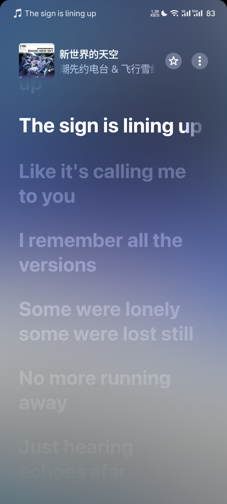
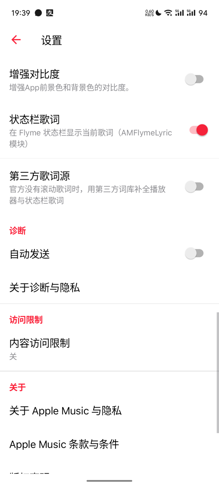

# AMFlymeLyric

让 **Apple Music** 的歌词显示在 **Flyme 状态栏**，并接管 Apple 官方缺失/无滚动的歌词。

LSPosed 模块（libxposed 新 API / API 102），作用域：`com.apple.android.music` + `com.android.systemui`。

## 功能

- **状态栏歌词**：复用 Flyme 媒体通知的 ticker 通道（`tickerText` + `FLAG_ALWAYS_SHOW_TICKER`，网易云同款机制），逐行推送。
- **图标适配**：白色凸版图标 + 按字形裁剪（左右各留 10px），随状态栏行高缩放，不再被 Flyme 的 `CENTER_INSIDE` 缩放压扁。
- **AM 设置页开关**：Apple Music → 设置 → 显示选项 里新增「状态栏歌词」「第三方歌词源」两个开关（R8 混淆下的 `androidx.preference` 注入）。
- **第三方歌词源**：AMLL / QQ 音乐 / 酷狗 / 网易云 **四源并行**，**逐字（karaoke）优先**，逐行/纯文本兜底；官方有滚动歌词时完全不介入。
- **暂停即隐藏**、通知去重、失败不重试等行为与 Flyme 原生一致（细节见文档）。

## 截图

| 播放器歌词页（第三方逐字歌词） | 显示选项里的两个开关 |
| --- | --- |
|  |  |

## 工作原理（一句话版）

Flyme 的 `AdvertTickerView` 读取媒体通知的 `tickerText`，并要求通知带 `FLAG_ALWAYS_SHOW_TICKER`、处于播放态；
模块 hook 住 Apple Music 的媒体通知与 MediaPlayer，歌词则来自 AM 内部的 TTML 管线
（官方 TTML，或由第三方词库生成的 Apple 风格 TTML），再按播放进度逐行改写 `tickerText` 重发通知。

逆向细节（Flyme ticker 机制、AM 媒体通知/队列/TTML 管线、`androidx.preference` 混淆成员表、DexSQL 用法）：
[docs/reverse-engineering.md](docs/reverse-engineering.md)；第三方词库部分：[docs/third-party-lyrics.md](docs/third-party-lyrics.md)。

## 编译

依赖：JDK 11+、Android SDK（build-tools + platforms）。

```bash
export ANDROID_SDK=/path/to/Android/Sdk
bash build.sh          # → build/AMFlymeLyric.apk
```

可选环境变量（详见 `build.sh` 顶部注释）：`XPOSED_API_JAR`（自带 libxposed API jar）、`KEYSTORE`/`KEYSTORE_PASS`/`KEY_ALIAS`（签名，缺省自动生成 `build/debug.keystore`）、`MIN_SDK`/`TARGET_SDK`、`JAVA_HOME`。

`stub/` 里是 libxposed API 102 的**最小声明**（只用于 javac，运行时不打包）。

## 安装 / 启用

```bash
adb install -r build/AMFlymeLyric.apk
```

1. LSPosed 管理器里启用模块，作用域勾选 **Apple Music** 与 **SystemUI**；
2. 重启 Apple Music 进程；SystemUI 侧首次需要让 LSPosed 重新加载配置：在管理器里把模块开关切一次（或重装），然后

   ```bash
   adb shell su -c 'kill -9 $(pidof com.android.systemui)'   # Flyme 会自动拉起
   ```

3. 播放任意带歌词的歌，状态栏应出现歌词；在 Apple Music → 设置 → 显示选项 里可随时关闭。

> SystemUI 作用域只有在 LSPosed 管理器的 UI 里切换才会持久化（直接改 `modules_config.db` 无效），这是 LSPosed 的设计。

## 目录结构

```
module/                    模块源码（APK 内容）
  src/com/amflymelyric/
    AmLyricModule.java     状态栏 ticker / 通知 hook / 设置页开关 / 注入调度
    ThirdPartyLyrics.java  多源并行调度、逐字优先选择、KRC/QRC/YRC/TTML 解析与校验
    LyricSources.java      AMLL / QQ / 酷狗 / 网易云 四个歌词源
    QqDes.java             QQ 音乐变体 DES（QRC 解密）
  resources/META-INF/xposed/{module.prop,java_init.list,scope.list}
stub/                      libxposed API 102 编译期声明
docs/                      逆向笔记、第三方词库说明、截图
build.sh                   构建脚本
```

## 已知限制

- 只在 MEIZU 20 / Flyme 12 / Android 16 上验证；其他 Flyme 版本 ticker 行为可能不同。
- 暂停时状态栏恢复时钟，这是 Flyme 的系统行为，模块不改。
- 第三方词库依赖各平台公开接口，随时可能失效；逐字 TTML 若被 AM 原生解析器拒绝会自动回退逐行。
- 纯本地实现，不修改、不分发 Apple Music 本体；仅供个人学习研究使用。

## 致谢

- [SPW-Lyrics](https://github.com/GaBoron/SPW-Lyrics)（MIT）：第三方歌词的获取/匹配/选择策略参考，`QqDes.java` 是其 `QqDesLike.kt` 的 Java 移植；
- LSPosed 与 libxposed 新 API；
- jadx、REA（逆向分析工具）。

## License

MIT，见 [LICENSE](LICENSE)。
